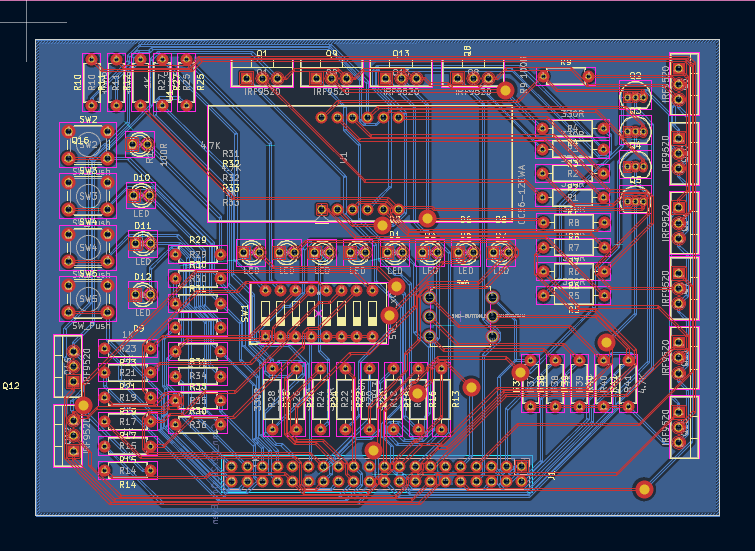
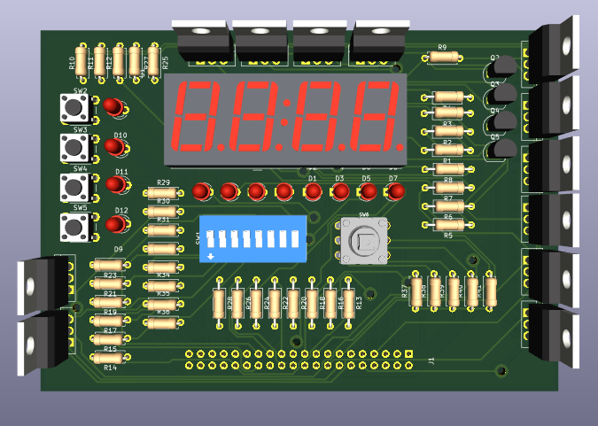
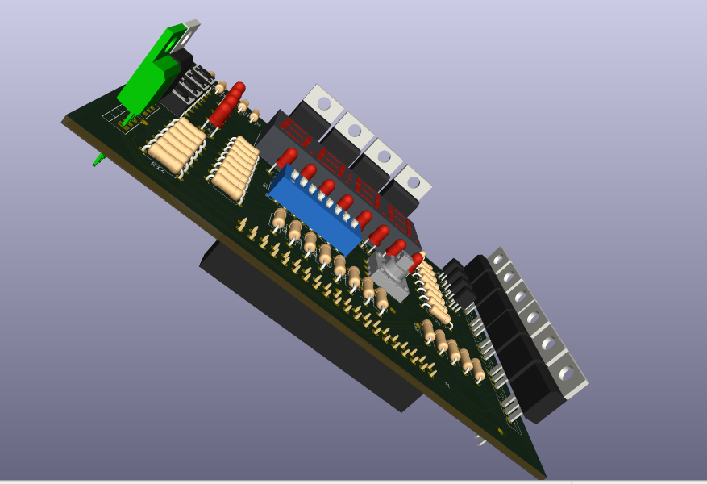

# ExtDE0_7Seg – KiCad port (through-hole, hand-made sandwich PCB)

Extension board for the Terasic **DE0** FPGA board: 4-digit 7-segment display, 8 DIP switches with LEDs, 4 push buttons with LEDs, and a 5-way joystick, all connected through the DE0 40-pin GPIO header.

This repository is a **KiCad re-capture and rework** of the original EPFL/LAP design, adapted to parts that are easy to source in Benin and to a home-made fabrication process.

> **Credit.** The original design is *ExtDE0_7Seg*, EPFL/LAP, R. Beuchat, Rev A, 01/2013 (Altium). The schematic structure and the I/O concept come from that work. Check the original author's licence/terms before publishing this repository, and keep this credit.

## Status

| Item | State |
|---|---|
| Schematic (KiCad, hierarchical, 5 sheets + root) | Done, ERC clean |
| Footprints assigned | Done |
| PCB routing (Freerouting) | Done, GND handled by a pour on B.Cu |
| DRC | 0 errors, 0 unconnected pads, silkscreen warnings only (checked 2026-08-27) |
| Gerber / drill export | Not done yet |
| Board fabricated | No |
| Hardware tested | **No** |

Nothing here has been built or powered yet. See [Known risks](#known-risks-to-check-before-powering-up).

## What changed compared to the original

| Area | Original (2013) | This version | Why |
|---|---|---|---|
| Parts | SMD (0603, SOT-23, resistor arrays) | All through-hole, discrete resistors | Hand soldering, home etching, local sourcing |
| Display | 6-digit KEM-3061-ASR (+ 4-digit LTC4627JR fallback), common anode | One 4-digit 5641AS-style module, **common cathode** | The 6-digit part is not obtainable |
| Digit select | pMOS, active low | nMOS (2N7000), active high | Common cathode must be sunk to GND |
| Segment select | nMOS, active high | pMOS (IRF9520), active low | Common cathode needs segments sourced from 3V3 |
| Reset (discharge) transistors | nMOS | pMOS to 3V3 | Opposite polarity, same purpose |
| P1 header | Generic 2x20 | 2x20 **female** socket (PinSocket 2.54 mm) | Plugs onto the DE0 GPIO pins |
| Fabrication | Industrial 2-layer | Two single-sided boards glued back to back | Material constraint, see below |

### Net names in the KiCad project

The KiCad nets still use some of the original names (`nSelDig0..3`, `SelSeg0..7`, `Reset_Led`) even though the polarity of those lines changed with the common-cathode rework. The names are misleading. Read the table below, not the names.

| Net | Drives | Active level (as built) |
|---|---|---|
| `nSelDig0..3` | Gate of 2N7000 (digit select, source to GND) | **High** |
| `SelSeg0..7` | Gate of IRF9520 (segment, source to 3V3) | **Low** |
| `Reset_Led` | Gates of the 4 reset pMOS (source to 3V3) | **Low** |

Your FPGA code (HDL) must follow these levels. Consider renaming the nets in a later revision.

## Hardware

### Bill of materials (summary)

| Ref | Part | Qty | Package |
|---|---|---|---|
| U1 | 4-digit 7-segment, common cathode (5641AS-style, 0.56") | 1 | THT, custom footprint |
| Digit select | 2N7000 (nMOS) | 4 | TO-92 |
| Segment select | IRF9520 (pMOS) | 8 | TO-220 |
| Reset | IRF9520 (pMOS) | 4 | TO-220 |
| Joystick | Alps SKQUDBE010, 5-way | 1 | Footprint converted from the SMD model, see notes |
| Push buttons | 6x6 mm, 4-pin tactile | 4 | THT |
| DIP switch | 8 positions | 1 | THT |
| LEDs | Yellow, green, orange, red x9 (D1 to D12) | 12 | 3 mm or 5 mm |
| Resistors | 4.7k, 1k, 560R, 330R, 100R, 56R, 0R (axial 1/4 W) | see KiCad BOM | THT |
| P1 | 2x20 female header, 2.54 mm | 1 | THT |

The authoritative list is the BOM exported from KiCad, not this table.

### Sheets

1. **Joystick** – five switches to GND, 4.7k pull-ups to 3V3, outputs `nJoystickN/S/E/W/C` (active low).
2. **Sw_LEDs** – 8-position DIP switch, two resistors and one LED per channel, outputs `Sw_Led0..7`.
3. **LED_Buttons** – 4 buttons with 4.7k pull-ups (`nButton0..3`, active low) and 4 independent LEDs driven by `LedButton0..3`.
4. **6Dig7Seg (4-digit)** – multiplexed display driver: digit-select nMOS, reset pMOS, segment-select pMOS, segment resistors.
5. **Connectors** – P1 (2x20 female) breakout of all nets.

Display multiplexing rule carried over from the original: select one digit at a time, and **never assert the reset transistor together with the digit select** of the same digit. A reset pulse is needed between two digit accesses.

## Fabrication: two-board sandwich

The design is drawn as a normal 2-layer board in KiCad. It is then built as two single-sided boards:

- **F.Cu = Board B**: signal traces, all components.
- **B.Cu = Board A**: GND pour (GND is not routed as traces).
- Every via is a hand-made wire link between the two boards.

Process:

1. Plot F.Cu + Edge.Cuts and B.Cu + Edge.Cuts as two separate artworks.
2. Etch both boards.
3. Clamp the two boards aligned and drill them together from the single drill file.
4. Solder a wire link in each via hole, then insert a thin insulating layer (leaving holes clear) and glue the boards.
5. Solder components from the board B side. Component leads only need to reach board A where the net is GND, or at a via.
6. Check continuity and shorts with a multimeter before applying power.

Design rules used: via 2.0 mm pad / 1.2 mm drill. Component hole minimum was lowered to match real leads. The GND zone uses thermal reliefs on THT pads to make hand soldering easier.

## Repository layout

```
7Seg_Ext.kicad_pro        KiCad project
7Seg_Ext.kicad_sch        root schematic
*.kicad_sch               sub-sheets
7Seg_Ext.kicad_pcb        board layout
docs/                     original PDF schematic (reference)
Gerber files/                   F.Cu and B.Cu plots, drill file (to be generated)
```

## Known risks to check before powering up

- **IRF9520 is not a logic-level MOSFET.** Driven from a 3.3 V FPGA pin its Vgs is only about -3.3 V, close to its threshold range. Segments may be dim or unreliable. Check the datasheet curves, and test one channel on a breadboard first. A logic-level pMOS (or a level-shifting stage) may be needed.
- **The common-cathode rework was derived by reasoning, not copied from the original netlist, and has not been simulated or tested.** Verify the display pinout and the segment/digit mapping against the real module with a multimeter.
- **P1 pin mapping** must match the DE0 GPIO header exactly. Verify every pin against the original PDF Connectors sheet and the DE0 manual before ordering copper.
- **Joystick footprint** was converted from an SMD model. Check pad positions and drill sizes against the Alps datasheet.
- **P1 orientation**: confirm pin 1 position, and that board thickness (two boards + insulator) still lets the socket seat on the DE0.
- **Alignment of the two boards** is the main mechanical risk. Drill them together.

## PCB layout


## PCB 3D Rendering

